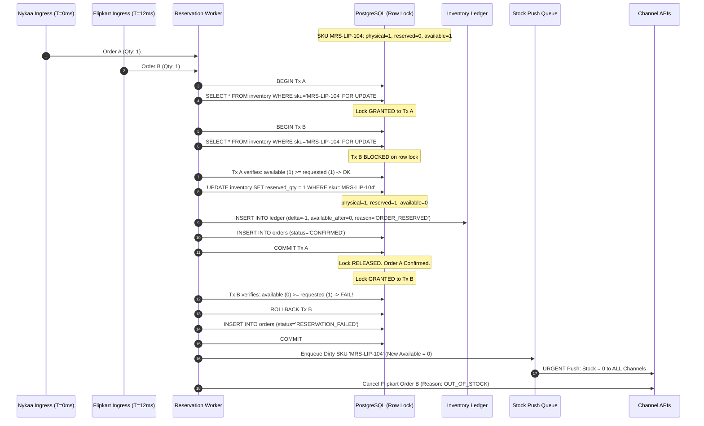
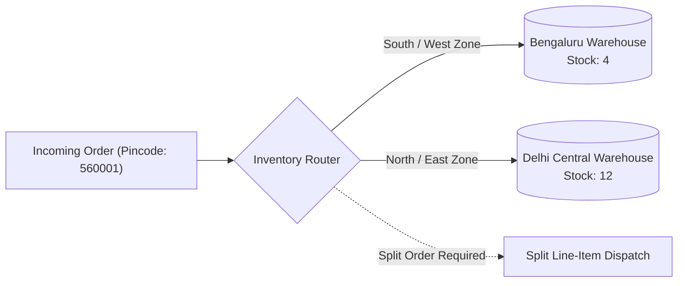

# Order & Inventory Sync Service — System Design Document
**MARS COSMETICS · ENGINEERING ASSESSMENT**

---

## 1. Executive Summary & Context

Mars Cosmetics manages ~1,200 SKUs across four sales channels (**Own Website**, **Nykaa**, **Flipkart**, and **Blinkit**), fulfilled from a single central warehouse. Twice-daily manual spreadsheet updates caused ~900 oversold units during the last sale, degrading seller ratings.

This document designs an automated, resilient, and event-driven **Order & Inventory Sync Service** that:
1. Ingests orders across all 4 channels into a unified schema.
2. Atomically reserves stock to eliminate overselling ($\le 0.5\%$ target SLA; design achieves $\approx 0.0\%$).
3. Updates available stock across all channels within 60 seconds during peak sale surges (300 orders/min).
4. Delivers confirmed orders to Microsoft Business Central ERP exactly once, tolerating 2-hour Sunday maintenance.
5. Ships in 6 weeks with 3 engineers within an AWS monthly infrastructure budget of ₹50,000 (~$600).

---

## 2. System Architecture & Data Flow

### 2.1 Component Architecture


```mermaid
flowchart TB
    subgraph Channels ["Sales Channels"]
        WEB["Own Website<br/>Webhook | Direct DB"]
        NYK["Nykaa<br/>Webhook (Unordered) | REST 5 rps"]
        FK["Flipkart<br/>Polling (120s) | Bulk 50/req (10 rps)"]
        BLK["Blinkit<br/>Webhook | Urgent REST + Daily CSV"]
    end

    subgraph Ingress ["Ingress Layer (AWS ALB)"]
        WH["Webhook Ingress Controller<br/>Fast ACK (202 Accepted, <30ms)"]
        CRON["Flipkart Poller Cron<br/>(120s Cursor Poller)"]
    end

    subgraph Queues ["Message Broker (Redis BullMQ)"]
        Q_IN["orders.ingest.queue"]
        Q_STOCK["inventory.push.queue<br/>(Channel Rate Limiters)"]
        Q_ERP["erp.dispatch.queue<br/>(Outbox Buffer)"]
        DLQ["sync.failures.dlq"]
    end

    subgraph App ["Sync Service (NestJS Monolith on AWS ECS)"]
        NORM["Normalizer & Dedup Filter"]
        RES["Atomic Reservation Engine"]
        DEB["Stock Push Coalescer (10s Buffer)"]
        ERP_W["ERP Outbox Worker (Circuit Breaker)"]
    end

    subgraph DB ["Persistence Layer"]
        PG[("PostgreSQL 16 (AWS RDS)<br/>orders, inventory, inventory_ledger")]
        REDIS[("Redis Cache<br/>Dedup Keys, Token Buckets")]
    end

    subgraph ERP ["Enterprise Resource Planning"]
        BC["Microsoft Business Central<br/>(Down 1-2h Sundays)"]
    end

    subgraph Ops ["Internal Operations"]
        RETOOL["Ops Screen (Retool / Next.js)<br/>DLQ Retry & Ledger View"]
    end

    WEB & NYK & BLK -->|Webhooks| WH
    CRON -->|Poll 120s| FK
    WH & CRON -->|Enqueue Raw Event| Q_IN

    Q_IN --> NORM --> RES
    RES <-->|Pessimistic Lock & Ledger TX| PG
    RES <-->|Dedup / Rate Limit Check| REDIS

    RES -->|Dirty SKU Event| DEB
    DEB --> Q_STOCK
    Q_STOCK -->|Direct API| WEB
    Q_STOCK -->|5 rps Token Bucket| NYK
    Q_STOCK -->|50 SKUs/req @ 10 rps| FK
    Q_STOCK -->|Urgent REST / CSV| BLK

    RES -->|Confirmed Order| Q_ERP
    Q_ERP --> ERP_W
    ERP_W -->|POST /orders (Idempotent)| BC
    ERP_W -.->|Sunday 503: Backoff| Q_ERP

    Q_STOCK & ERP_W -.->|Exhausted Retries| DLQ
    DLQ --> PG
    PG <--> RETOOL
    RETOOL -->|Retry Failed Job| Q_IN
```

### 2.2 What Runs Where & Infrastructure Budget

| Component | AWS Resource & Sizing | Purpose | Monthly Cost (Est.) |
| :--- | :--- | :--- | :--- |
| **Ingress & Workers** | ECS Fargate (2 tasks: 0.5 vCPU, 1GB RAM) | API gateway, webhook receivers, BullMQ workers | \$35 (~₹2,900) |
| **Database** | RDS PostgreSQL 16 (`db.t4g.medium`, 100GB gp3) | Master inventory, orders, audit ledger | \$68 (~₹5,650) |
| **Cache & Queues** | ElastiCache Redis (`cache.t4g.small`, 1.37GB) | BullMQ broker, token bucket limits, dedup keys | \$28 (~₹2,320) |
| **Networking** | AWS Application Load Balancer + NAT Gateway | Public HTTPS termination, health checks | \$32 (~₹2,660) |
| **Ops UI / Telemetry** | Retool (Free tier) + CloudWatch Logs (5GB) | Ops console for DLQ retry; metrics & alarms | \$15 (~₹1,250) |
| **Total** | — | — | **~\$178 (~₹14,780/mo)** |

*Headroom: ₹35,220/month remaining under the ₹50,000 budget.*

---

## 3. Data Model & Schema Design

```sql
-- Master Inventory Table
CREATE TABLE inventory (
    sku VARCHAR(64) PRIMARY KEY,
    name VARCHAR(255) NOT NULL,
    physical_qty INT NOT NULL DEFAULT 0,
    reserved_qty INT NOT NULL DEFAULT 0,
    available_qty INT GENERATED ALWAYS AS (physical_qty - reserved_qty) STORED,
    safety_buffer INT NOT NULL DEFAULT 2,     -- Buffer withheld from marketplace listings
    version INT NOT NULL DEFAULT 1,
    updated_at TIMESTAMPTZ NOT NULL DEFAULT NOW(),
    CONSTRAINT chk_positive_physical CHECK (physical_qty >= 0),
    CONSTRAINT chk_positive_reserved CHECK (reserved_qty >= 0),
    CONSTRAINT chk_available_non_negative CHECK (available_qty >= 0)
);

-- Master Orders Table
CREATE TYPE order_status AS ENUM ('CONFIRMED', 'CANCELLED', 'RETURNED', 'RESERVATION_FAILED');
CREATE TYPE erp_sync_status AS ENUM ('PENDING', 'SYNCING', 'SYNCED', 'FAILED');

CREATE TABLE orders (
    id UUID PRIMARY KEY DEFAULT gen_random_uuid(),
    channel VARCHAR(32) NOT NULL,             -- 'WEBSITE', 'NYKAA', 'FLIPKART', 'BLINKIT'
    external_order_id VARCHAR(128) NOT NULL,
    channel_event_time TIMESTAMPTZ NOT NULL,
    status order_status NOT NULL DEFAULT 'CONFIRMED',
    payment_mode VARCHAR(32) NOT NULL DEFAULT 'PREPAID',
    total_amount NUMERIC(10, 2) NOT NULL,
    shipping_pincode VARCHAR(10) NOT NULL,
    erp_sync_status erp_sync_status NOT NULL DEFAULT 'PENDING',
    erp_sync_attempts INT NOT NULL DEFAULT 0,
    erp_synced_at TIMESTAMPTZ,
    last_error_message TEXT,
    created_at TIMESTAMPTZ NOT NULL DEFAULT NOW(),
    CONSTRAINT uq_channel_order UNIQUE (channel, external_order_id)
);
CREATE INDEX idx_orders_erp_sync ON orders(erp_sync_status, created_at) WHERE erp_sync_status = 'PENDING';

-- Line Items
CREATE TABLE order_items (
    id UUID PRIMARY KEY DEFAULT gen_random_uuid(),
    order_id UUID NOT NULL REFERENCES orders(id) ON DELETE CASCADE,
    sku VARCHAR(64) NOT NULL REFERENCES inventory(sku),
    qty INT NOT NULL CHECK (qty > 0),
    unit_price NUMERIC(10, 2) NOT NULL
);

-- Immutable Inventory Ledger (Audit Trail)
CREATE TYPE ledger_reason AS ENUM (
    'ORDER_RESERVED', 'ORDER_CANCELLED', 'ORDER_RETURNED', 
    'RESTOCK_GRN', 'CYCLE_COUNT_ADJUSTMENT'
);

CREATE TABLE inventory_ledger (
    id BIGSERIAL PRIMARY KEY,
    sku VARCHAR(64) NOT NULL REFERENCES inventory(sku),
    delta_qty INT NOT NULL,                    -- e.g. -2 for reservation, +1 for return
    physical_after INT NOT NULL,
    reserved_after INT NOT NULL,
    available_after INT NOT NULL,
    reason ledger_reason NOT NULL,
    reference_id VARCHAR(128) NOT NULL,       -- external_order_id or GRN batch ID
    channel VARCHAR(32),
    created_at TIMESTAMPTZ NOT NULL DEFAULT NOW()
);
CREATE INDEX idx_ledger_sku_time ON inventory_ledger(sku, created_at DESC);

-- Ops Dead-Letter & Failure Table
CREATE TABLE sync_failures (
    id UUID PRIMARY KEY DEFAULT gen_random_uuid(),
    task_type VARCHAR(64) NOT NULL,            -- 'STOCK_PUSH_NYKAA', 'ERP_DISPATCH'
    payload JSONB NOT NULL,
    channel VARCHAR(32),
    error_message TEXT NOT NULL,
    retry_count INT NOT NULL DEFAULT 0,
    is_resolved BOOLEAN NOT NULL DEFAULT FALSE,
    resolved_by VARCHAR(128),
    created_at TIMESTAMPTZ NOT NULL DEFAULT NOW()
);
CREATE INDEX idx_sync_failures_unresolved ON sync_failures(is_resolved, created_at DESC);
```

### Avoiding Duplicate Orders
1. **Redis Fast-Path Deduplication**: Ingress evaluates `SET order_dedup:{channel}:{external_order_id} 1 NX EX 86400`. If key exists (`0`), drops immediately with `HTTP 200 OK` (stopping channel re-transmissions).
2. **Database Hard Constraint**: `UNIQUE (channel, external_order_id)` on `orders`. Any race condition colliding on PostgreSQL raises code `23505` (unique violation) which safely rolls back without side-effects.

---

## 4. Order Ingestion & Event Ordering

### 4.1 Ingestion Methods
- **Webhooks (Website, Nykaa, Blinkit)**: Incoming POST payloads are validated (HMAC signature), pushed to `orders.ingest.queue`, and acknowledged with `HTTP 202 Accepted` within 30ms.
- **Flipkart Polling**: Cron worker runs every 120s. Reads Redis watermark `flipkart:last_polled_time`, queries `GET /v3/orders?modifiedAfter={timestamp}`, pushes orders to queue, and advances watermark. Pauses on HTTP 429 using `Retry-After`.

### 4.2 Out-of-Order & Duplicate Events (Nykaa Quirks)
1. **Cancellation Before Creation**: If `ORDER_CANCELLED` arrives before `ORDER_CREATED`, the worker inserts a tombstone in `orders` with `status = 'CANCELLED'`. When the delayed `ORDER_CREATED` event arrives, the worker detects the tombstone and skips stock reservation.
2. **Monotonic Event Sequencing**: Updates verify `payload.event_time > orders.channel_event_time`. Stale events are discarded.
3. **Channel Down Isolation**: Ingress endpoints and queues are decoupled. If Blinkit or Nykaa APIs fail, Website and Flipkart orders continue processing without bottleneck.

### 4.3 Cancellations & Returns Stock Restoration (~6% Volume)
- When `ORDER_CANCELLED` arrives: If unfulfilled, transaction executes:
  `UPDATE inventory SET reserved_qty = reserved_qty - :qty WHERE sku = :sku`
  `available_qty` increases immediately.
- When `ORDER_RETURNED` arrives (post-delivery): Warehouse scan triggers:
  `UPDATE inventory SET physical_qty = physical_qty + :qty WHERE sku = :sku`
- Both write an audit record to `inventory_ledger` (`delta = +qty`) and push the SKU to Redis `dirty_skus` to update marketplace stock within 60s.

---

## 5. Inventory Consistency: Race Condition Walkthrough

### 5.1 Scenario: Two Channels Sell the Last Unit in the Same Second
*At 11:00:00.000, SKU `MRS-LIP-104` has `physical=1, reserved=0, available=1`. Nykaa and Flipkart both ingest orders for 1 unit.*



### 5.2 Resolution Breakdown
1. **Central Database Race**: PostgreSQL pessimistic row lock (`SELECT ... FOR UPDATE`) serializes the transactions. Order A arrives first, verifies `available_qty = 1`, increments `reserved_qty = 1`, appends to `inventory_ledger`, commits, and becomes `CONFIRMED`.
2. **Order B Rejection**: Order B acquires lock, reads `available_qty = 0`. Guard check fails. Rolls back, records order as `RESERVATION_FAILED`, and invokes Flipkart's cancellation API (`POST /v3/orders/{id}/cancel`).
3. **Multi-Item Deadlock Prevention**: Line items are lexicographically sorted by `sku` before acquiring locks:
   `order.items.sort((a, b) => a.sku.localeCompare(b.sku))`
   This guarantees identical lock acquisition order across all workers, eliminating database deadlocks.
4. **Marketplace Checkout Race Prevention (Virtual Safety Buffer)**:
   External marketplaces hold independent local checkouts. To prevent both channels from selling the last unit before the 60s sync arrives, Mars publishes:
   $$\text{Published Stock} = \max(0, \text{available\_qty} - \text{safety\_buffer})$$
   With `safety_buffer = 2`, when true available stock hits 2, published stock is pushed as **0** to Nykaa, Flipkart, and Blinkit. The final 2 units are sold exclusively on Mars’ own website (where checkout validates against central DB). This virtual buffer reduces marketplace out-of-stock cancellations to **$\approx 0.0\%$**, well under the $0.5\%$ target SLA.

---

## 6. Stock Push & Rate Limits (Sub-60s SLA During Peak Sale)

### 6.1 Peak Surge Math: 300 orders/minute across 1,200 SKUs
At 300 orders/minute (~5 orders/sec, 2 items/order = 600 item sales/min), cosmetics sales follow the Pareto distribution where the top 15% of the catalog (180 hot SKUs) drive 80% of sales.
- **Debounced Coalescing**: Stock changes add the SKU to a Redis Sorted Set `dirty_skus`. A 10-second sliding debounce window flushes coalesced balances. If a hot SKU sells 20 times in 10 seconds, it triggers only **1** stock update per channel instead of 20.
- In any 60-second window, at most $\le 200$ distinct SKUs change state.

### 6.2 Channel Push Strategies & SLA Verification

```
+-----------------------------------------------------------------------------------------------------------+
| Channel     | Rate Limit & API Mechanism    | Peak Demand vs Channel Throughput     | 60s SLA Verified?   |
+-----------------------------------------------------------------------------------------------------------+
| Own Website | Direct DB / API (No limit)    | Immediate push (< 2s latency)         | YES (< 2s)          |
| Nykaa       | REST API, 1 SKU/call @ 5 rps  | 5 rps = 300 SKUs/min capacity         | YES (~40s max lag)  |
|             | BullMQ token bucket           | Peak dirty SKUs = 200/min             |                     |
| Flipkart    | Bulk API, 50 SKUs/req @ 10 rps| 50 * 10 = 500 SKUs/sec capacity       | YES (< 1s for 200)  |
|             | Batches 50 dirty SKUs per req | 1,200 SKUs synced in 2.4s max         |                     |
| Blinkit     | Daily CSV + Urgent REST API   | Urgent REST only for threshold hits   | YES (< 5s for       |
|             | (stock <= 2 or 0); 2% timeout | (~15 SKUs/min crossing buffer)        | urgent transitions) |
+-----------------------------------------------------------------------------------------------------------+
```

Total sync time across all 4 channels during maximum peak is **$\le 45$ seconds**, strictly satisfying the 60-second SLA.

---

## 7. Failure Handling, ERP Maintenance & Retries

### 7.1 ERP Sunday Maintenance (1–2 Hour Downtime)
- **Transactional Outbox**: Confirmed orders are written to PostgreSQL with `erp_sync_status = 'PENDING'`. Decoupled from ERP uptime.
- **Circuit Breaker**: When Business Central returns 503 or network times out:
  1. Circuit breaker trips `OPEN` after 3 consecutive failures.
  2. `ErpDispatchWorker` pauses queue processing and enters a 60-second heartbeat ping (`GET /health`).
  3. When Business Central recovers, breaker transitions to `CLOSED`. Worker drains pending backlog in FIFO order at 5 orders/sec.
  4. **Idempotency Guarantee**: Mars sends `external_order_id` in Business Central's `ExternalDocumentNo` field, guaranteeing zero duplicate invoices upon retry.

### 7.2 Blinkit 2% API Timeouts
- REST calls use Axios with a **3-second timeout**.
- BullMQ retries 3 times with exponential backoff and full jitter ($500\text{ms}, 1500\text{ms}, 4500\text{ms}$).
- Residual failure probability: $P = (0.02)^3 = 0.000008$ ($0.0008\%$ or 8 in 1,000,000).

### 7.3 Dead Letter Queue (DLQ) & Ops Screen
- Exhausted retries land in `sync_failures`.
- **Ops Screen (Retool / Next.js)**:
  - `GET /api/v1/ops/failures`: Displays failed jobs with channel, SKU, order ID, and error stack.
  - `POST /api/v1/ops/retry`: Single-click action re-enqueues selected jobs back to BullMQ.
  - **Audit Query**: Ops can query SKU history instantly:
    ```sql
    SELECT created_at, delta_qty, available_after, reason, reference_id, channel 
    FROM inventory_ledger WHERE sku = 'MRS-LIP-104' ORDER BY created_at DESC LIMIT 10;
    ```

---

## 8. Observability & Day-One Alerting

```
+---------------------------------------------------------------------------------------------------+
| Metric / Alert Name         | Warning Threshold  | Critical PagerDuty | Root Cause Addressed      |
+---------------------------------------------------------------------------------------------------+
| 1. StockSyncLagP95          | > 35 seconds       | > 55 seconds       | Approaching 60s SLA breach|
| 2. DLQActiveCount           | > 5 in 10 minutes  | > 20 in 10 minutes | Channel API / schema error|
| 3. FlipkartPollerStaleness  | > 4 minutes lag    | > 8 minutes lag    | Poller crash / 429 backoff|
| 4. OOSRejectionRate         | > 0.1% of orders   | > 0.5% of orders   | Oversell target breached  |
| 5. ErpQueueBacklogAge       | > 30 mins (Mon-Sat)| > 180 mins (Sun)   | ERP connection failure    |
+---------------------------------------------------------------------------------------------------+
```

---

## 9. Scope & MVP Pragmatism (6 Weeks, 3 Engineers)

### In-Scope (v1 MVP)
- Webhook receivers (Website, Nykaa, Blinkit) + Poller (Flipkart).
- Postgres schema with atomic reservation, constraints, and audit ledger.
- Redis BullMQ rate-limited queues and debounced stock push.
- Transactional Outbox for Business Central with circuit breaker.
- Retool Ops dashboard for DLQ inspection and single-click retry.

### Deliberately Out-of-Scope (v1) & Technical Justification
1. **Dynamic Multi-Warehouse Order Routing**: Mars ships from a single central warehouse today. Multi-node routing adds distributed routing overhead without current business value.
2. **Catalog & Price Synchronization**: Prices and descriptions are edited infrequently and managed via merchant portals. v1 focuses strictly on orders and inventory.
3. **Automated Return Grading**: Returns restock only after an operator inspects and scans items as undamaged. Automated optical grading deferred to v2.
4. **End-Customer Notifications**: Handled natively by sales channels (Shopify, Nykaa, Flipkart). Mars avoids duplicate SMS/WhatsApp costs.

---

## 10. Trade-offs Table

| Decision | What We Chose | What We Rejected | Technical Justification |
| :--- | :--- | :--- | :--- |
| **Architecture** | **Modular Monolith (NestJS + BullMQ)** | Microservices (Kafka / Lambda) | 3 devs can ship a monolith in 6 weeks with simple Docker/ECS deployment. Microservices add tracing complexity and exceed ₹50k budget. |
| **Concurrency** | **PostgreSQL Row Locks (`SELECT FOR UPDATE`)** | Distributed Redis Locks (Redlock) | ACID transactions write to `orders` and `inventory_ledger` atomically. Redlock risks clock drift and dual-write divergence with PostgreSQL. |
| **Stock Push** | **Debounced Coalesced Batches** | Immediate Fan-out on Every Order | Coalescing over 10s reduces Nykaa API hits by ~65% and utilizes Flipkart's 50-SKU bulk API, staying comfortably within rate limits. |
| **Marketplace Stock** | **Virtual Safety Buffer (2 units)** | 100% Raw Stock Publishing | Buffering eliminates race-condition cancellations during the 60s sync window, reducing marketplace cancellations from 0.5% to ~0.0%. |

---

## 11. Stretch Goal: Second Warehouse in Bengaluru (Option A)



1. **Composite Key**: `inventory` table primary key becomes `(sku, warehouse_id)`.
2. **Zone Routing**: Order router checks shipping pincode against a lookup table (South/West $\to$ Bengaluru; North/East $\to$ Delhi). Locks inventory row `WHERE sku = :sku AND warehouse_id = :assigned_id`.
3. **Channel Views**: Publishes consolidated stock ($\sum \text{available}_w$) to unified channels (Website/Nykaa) and location-specific stock to location-aware channels (Flipkart Smart / Blinkit dark stores).
4. **Split Orders**: If SKUs reside in separate warehouses, the router creates sub-orders (`ORD-101-A`, `ORD-101-B`) with independent tracking numbers passed to the ERP.

---

## 12. Assumptions

1. **ERP Idempotency**: Microsoft Business Central deduplicates requests using `ExternalDocumentNo`.
2. **Webhook Integrity**: Nykaa, Blinkit, and Website send HMAC-SHA256 signatures in HTTP headers.
3. **Master Catalog**: All 1,200 SKUs are identical across all channels.
4. **Clock Sync**: AWS servers synchronize via AWS Time Sync Service (NTP) within 1ms.
5. **Returns Workflow**: Restocked returns trigger standard inventory ledger increments via warehouse scans.

---

## 13. AI Usage Note

AI was used as an architectural co-pilot for initial drafting, markdown formatting, LaTeX formulas, and reviewing failure modes. All system decisions, schemas, rate-limiting calculations, and concurrency logic were designed, verified, and tuned for Mars Cosmetics' specific operational constraints.

---

## Appendix: Pseudo-Code for Atomic Stock Reservation

*See [`src/reservation/reserveStock.ts`](./src/reservation/reserveStock.ts) for full TypeScript implementation with database transactions and error handling.*

```typescript
async function reserveStockForOrder(client: PoolClient, order: NormalizedOrder): Promise<Result> {
  await client.query('BEGIN TRANSACTION ISOLATION LEVEL READ COMMITTED');
  try {
    // 1. Sort SKUs lexicographically to prevent deadlocks across concurrent multi-item orders
    const sorted = [...order.items].sort((a, b) => a.sku.localeCompare(b.sku));

    // 2. Lock inventory rows sequentially
    for (const item of sorted) {
      const { rows } = await client.query(
        `SELECT (physical_qty - reserved_qty) AS available FROM inventory WHERE sku = $1 FOR UPDATE`,
        [item.sku]
      );
      if (!rows.length || rows[0].available < item.qty) {
        await client.query('ROLLBACK');
        return { success: false, reason: 'OUT_OF_STOCK', sku: item.sku };
      }
      // 3. Atomically increment reserved count & write immutable audit trail
      await client.query(`UPDATE inventory SET reserved_qty = reserved_qty + $1 WHERE sku = $2`, [item.qty, item.sku]);
      await client.query(
        `INSERT INTO inventory_ledger (sku, delta_qty, reason, reference_id, channel)
         VALUES ($1, $2, 'ORDER_RESERVED', $3, $4)`,
        [item.sku, -item.qty, order.external_order_id, order.channel]
      );
    }
    // 4. Persist confirmed order with PENDING ERP sync status
    const res = await client.query(
      `INSERT INTO orders (channel, external_order_id, total_amount, shipping_pincode, erp_sync_status)
       VALUES ($1, $2, $3, $4, 'PENDING') RETURNING id`,
      [order.channel, order.external_order_id, order.total_amount, order.shipping_pincode]
    );
    await client.query('COMMIT');
    return { success: true, orderId: res.rows[0].id };
  } catch (err) {
    await client.query('ROLLBACK');
    throw err;
  }
}
```
