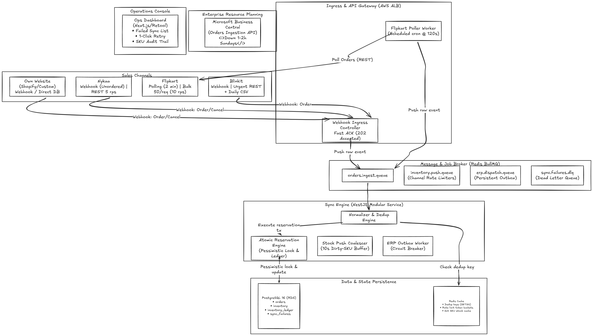

# Mars Cosmetics — Order & Inventory Sync Service

System design and concurrency architecture for the multi-channel **Order & Inventory Sync Service** for **Mars Cosmetics**.

---

## 📌 Approach Overview

Mars Cosmetics fulfills ~1,200 SKUs across four sales channels (**Own Website**, **Nykaa**, **Flipkart**, and **Blinkit**) from a single central warehouse. 

Our architectural approach solves the core engineering challenges:

1. **Zero Overselling ($\approx 0.0\%$ target SLA)**:
   - **Ingress Layer Race**: Handled through PostgreSQL 16 row-level pessimistic locking (`SELECT ... FOR UPDATE`) inside an ACID transaction. SKUs are lexicographically sorted prior to row locking to eliminate multi-item deadlocks.
   - **Distributed Marketplace Checkout Race**: Because external marketplaces host independent checkouts, we implement a **Virtual Safety Buffer** (`published_stock = max(0, available - 2)`). External channels drop to 0 stock when warehouse stock hits 2, reserving the final units exclusively for Mars' own website.

2. **Sub-60s Multi-Channel Stock Push (300 orders/min Peak)**:
   - Instead of flooding third-party APIs on every order, we implement a **10-Second Debounced Dirty-SKU Coalescer** in Redis.
   - During peak sales, dirty SKUs are dispatched through channel-specific rate-limited queues:
     - **Website**: Direct DB / Cache invalidate ($< 2$s latency).
     - **Nykaa**: Token bucket limited to 5 req/s (300 SKUs/min capacity $\implies < 40$s flush).
     - **Flipkart**: Coalesced batches of 50 SKUs via Bulk API at 10 req/s (500 SKUs/sec capacity $\implies < 1$s flush).
     - **Blinkit**: Daily CSV for catalog baseline; urgent REST API reserved for threshold transitions ($\le 2$ or $=0$).

3. **ERP Outbox & Sunday Maintenance Resilience**:
   - Customer order confirmations are decoupled from Microsoft Business Central availability via the **Transactional Outbox Pattern**.
   - An automated circuit breaker detects Sunday 503s/timeouts, pauses dequeueing, and polls health every 60s. Orders drain in FIFO order upon recovery with `external_order_id` passed via `ExternalDocumentNo` for native idempotency.

4. **Pragmatic Delivery**:
   - Designed as a **NestJS Modular Monolith** on AWS ECS with PostgreSQL and Redis BullMQ.
   - Fits comfortably within the ₹50,000/month infrastructure budget (**~\$178/mo or ~₹14,780/mo**) and can be delivered by 3 engineers in 6 weeks.

---

## 🏗️ System Architecture



---

## 📂 Repository Layout

```text
mars-order-inventory-sync/
├── DESIGN.md                     # Main 4-page system design document (Core deliverable)
├── README.md                     # Approach overview and setup instructions
├── diagram.png                   # Architecture diagram (PNG export)
└── src/
    └── reservation/
        └── reserveStock.ts       # Production-grade TypeScript implementation for Q4
```

---

## 🚀 Setup & Local Inspection Steps

To review and inspect the service locally:

### Prerequisites
- [Node.js](https://nodejs.org/) (v18 or v20+)
- [Docker](https://www.docker.com/) & Docker Compose (optional, for local DB testing)

### Step 1: Clone the Repository
```bash
git clone https://github.com/<YOUR_USERNAME>/<YOUR_REPO_NAME>.git
cd <YOUR_REPO_NAME>
```

### Step 2: Review the Core Deliverable
Open **[`DESIGN.md`](./DESIGN.md)** to inspect the complete system design:
- **Section 2**: Component Architecture & Infrastructure Budget
- **Section 3**: Relational Data Model & Deduplication
- **Section 4**: Order Ingestion & Returns Restocking (6% volume)
- **Section 5**: Concurrency & Race Condition Resolution
- **Section 6**: Stock Push & Rate-Limit Throughput Math
- **Section 7**: Failure Handling, Retries & ERP Sunday Downtime
- **Section 8**: Day-One Observability & Metrics
- **Section 9**: Scope Boundaries (v1 vs v2)
- **Section 10**: Trade-offs Table (4 explicit decisions)
- **Section 11**: Stretch Goal A (Second Warehouse in Bengaluru)
- **Section 12**: Assumptions
- **Section 13**: AI Usage Note

### Step 3: Inspect the Concurrency Logic
The atomic stock reservation pseudo-code is located in **[`src/reservation/reserveStock.ts`](./src/reservation/reserveStock.ts)**. It demonstrates:
- Sequential row locking with `SELECT ... FOR UPDATE`
- Deterministic lexicographical SKU sorting (deadlock prevention)
- Available balance checks (`physical_qty - reserved_qty >= requested_qty`)
- Atomic reservation updates & append-only `inventory_ledger` audit writes

---

## 📊 Summary of Channel Limits & Handling

| Channel | Ingestion Strategy | Stock Push Strategy | Limits & Quirks | Our Mitigation |
| :--- | :--- | :--- | :--- | :--- |
| **Own Website** | Webhook | Direct DB / API | No limits | Real-time push ($< 2$s) |
| **Nykaa** | Webhook | REST API (1 SKU/call) | 5 req/s; duplicate/unordered events | Redis SETNX dedup + event timestamp versioning + 5 rps BullMQ token bucket |
| **Flipkart** | Poller Cron (120s) | Bulk API ($\le 50$ SKUs/call) | 10 req/s; 429 backoff | Cursor-based poller + coalesced bulk batching (up to 500 SKUs/s capacity) |
| **Blinkit** | Webhook | Daily CSV + Urgent REST | 2% REST timeout rate | Fast webhook ACK + 3-attempt exponential backoff with full jitter ($P(\text{failure}) = 0.0008\%$) |
| **Business Central** | — | Transactional Outbox | 1–2h Sunday maintenance | Decoupled queue + circuit breaker + `ExternalDocumentNo` idempotency |
